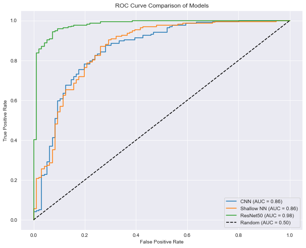
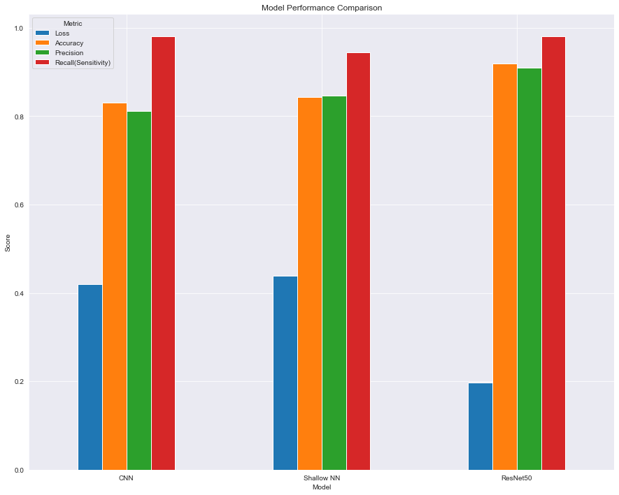

# Deep Learning Classifiers for Breast Cancer Histopathology

Classifying breast tissue biopsies as **benign or malignant** from
histopathology images, comparing three neural network architectures.

Group project with **Renk Asik**, **Leon Igal Inselberg Barbut** and
**Payal Priyadarshini** (equal contribution), Freie Universität Berlin.

## Problem

Breast cancer is among the most common cancers in women, and early, accurate
classification materially changes patient outcomes. The BreaKHis database
provides histopathological slide images at four magnifications. The question is
whether a network can separate benign from malignant tissue — and how much
architecture matters against simply having more data or a better magnification.

## Approach

Images are loaded with their benign/malignant labels at a chosen magnification,
split into train, validation and test sets, and the class balance of each split
is checked before training. Three architectures are then trained on identical
data and compared on the same test set:

1. a **custom CNN** — convolution, pooling and dense layers built from scratch
2. a **shallow fully-connected network** with a single hidden layer, as a
   deliberately weak baseline
3. **ResNet-50**, pre-trained and fine-tuned

## Results

| model | accuracy | precision | recall (sensitivity) | AUC |
|---|---|---|---|---|
| CNN | 0.830 | 0.812 | 0.981 | 0.86 |
| Shallow NN | 0.843 | 0.846 | 0.944 | 0.86 |
| **ResNet-50** | **0.920** | **0.910** | **0.981** | **0.98** |



**ResNet-50 wins decisively** — 92% accuracy and an AUC of 0.98 against 0.86 for
both from-scratch models. Transfer learning from ImageNet features beats
training a convolutional network from scratch on a dataset this size, which is
the expected result and worth having demonstrated rather than assumed.

Two things in the table are worth more than the headline:

**The shallow network slightly outperformed the custom CNN** on accuracy
(0.843 vs 0.830) despite having no convolutional structure at all. A CNN only
earns its keep if it has the depth and the data to learn useful filters; this
one did not, and a simple baseline exposed that.

**Recall is high for every model** (0.94–0.98), and that is the metric that
matters most here. A false negative means telling a patient with malignant
tissue that they are clear. All three models are tuned toward catching
malignancy at the cost of some false positives — the right trade for a
screening task, and the reason accuracy alone would be a misleading summary.



## Contents

| File | What it is |
|---|---|
| [`notebooks/a2_breakhis_cnn.ipynb`](notebooks/a2_breakhis_cnn.ipynb) | The full comparison: data loading, splits, all three models, ROC analysis |
| [`notebooks/a3_breakhis_mag100.ipynb`](notebooks/a3_breakhis_mag100.ipynb) | Classifier at 100× magnification |
| [`reports/final_report.pdf`](reports/final_report.pdf) | Final project report |
| [`reports/`](reports) | Assignment reports, including the 400× results, and the project presentation |
| [`figures/`](figures) | ROC curves and the metric comparison |

**Stack:** TensorFlow/Keras, ResNet-50, scikit-learn, pandas, seaborn, matplotlib

## Getting the data

**BreaKHis v1** is ~4 GB and is not included here. Download it from the
[P&D Laboratory, Federal University of Paraná](https://web.inf.ufpr.br/vri/databases/breast-cancer-histopathological-database-breakhis/)
and extract so the notebooks find:

```
BreaKHis_v1/histology_slides/breast/{benign,malignant}/SOB/<tumour-type>/<slide>/<magnification>/
```

The notebooks read the magnification folder (`40X`, `100X`, `200X`, `400X`) and
derive the label from the path.

> The 400× analysis survives only as its write-up,
> [`reports/a3_mag400_report.pdf`](reports/a3_mag400_report.pdf), and the figure
> [`reports/magnification_400.png`](reports/magnification_400.png); the notebook
> itself was lost. The 100× notebook
> [`notebooks/a3_breakhis_mag100.ipynb`](notebooks/a3_breakhis_mag100.ipynb) runs the
> same pipeline and reproduces it by pointing at the `400X` folder instead.
